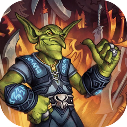

  

<h1 align="center">Auction House</h1>

  A free Discord bot for <b>WoW Forever</b> auction house prices.  
  <a href="https://discord.com/oauth2/authorize?client_id=1572743737703141396"><b>Add it to your server</b></a>

## Commands

| Command | What it does |
|---|---|
| <code>/price&nbsp;&lt;item&gt;</code> | Lowest and average price on Normal and PvP, for Alliance and Horde. Autocompletes item names. |
| <code>/sticky&nbsp;set</code> | Keeps a message at the bottom of a channel (admins). |
| <code>/sticky&nbsp;remove</code> | Removes it again (admins). |

Prices update every hour. "Avg price" is the average of the cheapest 15% of listings.

## Good to know

- Adding the bot requires **Manage Server**.
- To keep `/price` in one channel: **Server Settings → Integrations → Auction House → Channels**.
- No user data is stored. The only thing saved is the sticky text per channel.

---

© 2026 mrdonald007. Source available for transparency. All rights reserved. 
Not affiliated with Blizzard Entertainment.
